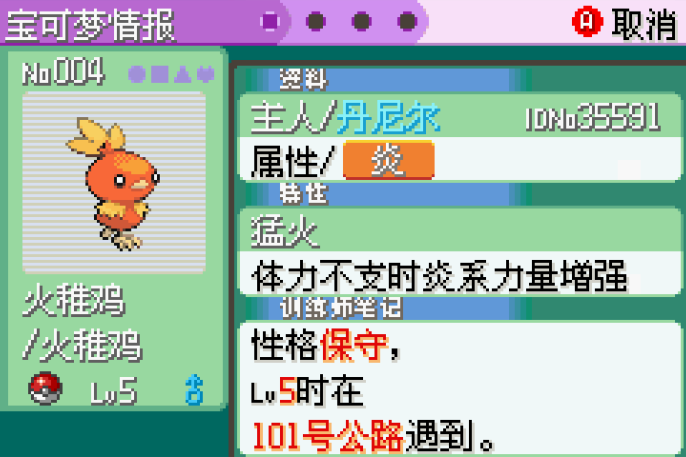
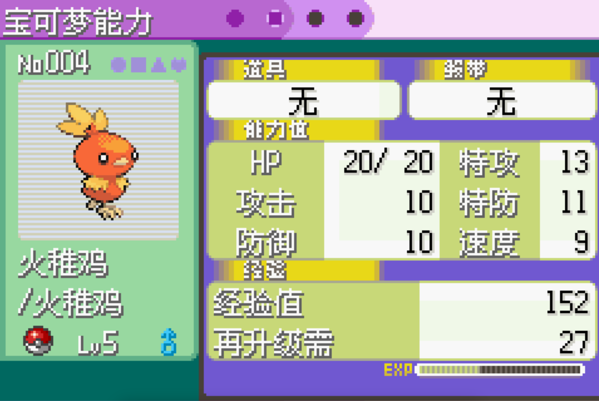
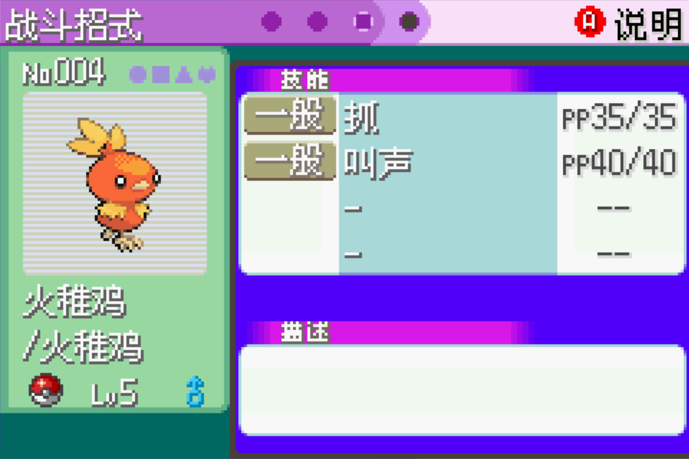

# 花花小窝布局参考

- 入口：首页点击新叶喵，进入 `sprigatito` 聚焦状态；URL 仍为 `/`。
- 实现：`src/views/Home/TemplePage.vue`、`components/FloraFocusLayout.vue` 与 `templeScene.ts`；构图参数集中于 `src/config/floraLayout.ts`。
- 花花小窝属于首页三维场景模块，不是独立宠物路由，也不是猫咪图片页。
- 来源：用户于 2026-10-12 提供的三张宝可梦详情截图，原图完整保存在本目录。
- 修改前须查看三张图，并结合用户当次意见实现；用户明确意见优先。

## 参考图

1. 资料页：左侧角色形象与身份信息，右侧纵向资料模块。
   
2. 能力页：左侧角色区保持一致，右侧排列能力与经验模块。
   
3. 招式页：左侧角色区保持一致，右侧排列技能列表与描述模块。
   

## 当前实现范围

- 桌面端左侧围绕花花模型布局，右侧预留内容模块；1/3 仅为目测参考，不固定为 1:2。手机端按当次要求采用上小下大的上下布局。
- 左侧宽度按页面宽度 38% 的基准扣除左右留白计算，右侧占用剩余空间；模型最终位置由页面宽度 19.5% 左移至 18%，分区宽度与模型取景独立调整。
- 左右复用菜单内容边距；顶部与菜单栏底部间隔 16px，底部与 `FooterCom` 顶部间隔为 32px，布局底边相对原始位置上移 16px。避让以组件实际位置计算，手机端模型构图同步使用缩小后的可用高度。
- 两个分区之间保留 16px 透明间距，左侧按构图参数确定宽度，右侧自适应剩余空间。
- 左侧顶部编号栏：左边使用字符符号 `№ 001`，右边依次为宠物主题色圆形、正方形、三角形、五角星、菱形、爱心；前五个使用 `1.5` 单位描边镂空，爱心保持实心。
- 右侧六个图标之间保留响应式间距：`clamp(1px, 1cqw, 5px)`，为此前的一半。
- 右侧六个图标保持正形，不使用倾斜变换；编号保持 Anton 正体。
- 圆形、正方形、三角形、五角星、菱形各自从左到右渐隐，不透明度从 100% 降至 0%；渐隐遮罩与扫描线遮罩取交集。爱心保持实心与扫描线，不使用渐隐遮罩。
- 编号使用站点已有的 Anton 字体（400），不显示边框；使用父层渐隐遮罩，不透明度从顶部 70% 连续降至底部 10%。
- 聚焦模块挂载或切换宠物时，编号用 600ms 渐显；`№` 保持显示，数字从 240ms 开始逐位出现，间隔 320ms，每位在 240ms 内快速闪烁两次，不使用下划线；始终预留完整字符宽度。系统启用减少动态效果时直接显示完整编号。
- 编号栏四周保留响应式内边距：`clamp(6px, 4cqw, 24px)`。
- 编号框与右侧符号组顶部对齐。
- 编号自身内边距为 0，无边框；基础高度为 `1em`，用 `0.5em` 底部外边距补足纵向拉伸占位。
- 编号从顶部向下纵向拉伸 1.5 倍，宽度保持不变；补足拉伸后的布局占位，避免换行时与符号重叠。
- 编号字号放大为此前的 1.5 倍，去除内边距后再等比放大 25%，使用 `clamp(37.5px, 26.25cqw, 120px)`，手机端为 `45px`；图标尺寸保持初版 2 倍。逐字符／逐图标使用不规则扫描线遮罩：上细下粗、底部实心，各自条纹起点和间隔不同。编号从上到下逐渐淡化，图标保留暗红色。空间不足时自动换行，图标组仍靠右对齐。
- 扫描线效果参考 `scanline-reference.png`；复用算法见 `../../scanline-mask.md`，实现为 `src/utils/scanlineMask.ts`。
- 各字符扫描线覆盖高度独立变化，默认在字框高度 42%–72% 范围内结束，下面保持实心；不要将所有字符固定在同一终点，也不要逐字随机缩放字形。
- 两区使用透明背景与 1px 实线边框，复用站点边框色；手机端改为上下分区：扣除 16px 间距后，上方模型区占 36%、下方内容区占 64%；模型水平居中，中心位于上区高度的 62% 处，为编号栏留出空间。手机端聚焦相机拉远，取景占比从 0.45 调整为 0.22，最终模型更小；桌面端构图不变。
- 网站全局层提供方形按钮，固定紧贴视口左下角（`left: 0; bottom: 0`），通过 `App.vue` 挂载并传送到 `body`，不随路由容器移动。
- 按钮视觉隐藏（`opacity: 0`），仍保留左下角 36px × 36px 点击区域与键盘操作。
- 分区边框默认隐藏；开关状态跨路由保留，重新加载网站恢复默认隐藏。切换不改变分区尺寸或编号栏位置。
- 分区边框须位于三维画布上方，覆盖整个分区高度，避免地面遮挡下半部分；保持点击穿透到场景。
- 复用首页新叶喵三维模型、聚焦运镜、灯光与手势；分区以模型位置为准，不为固定比例修改模型大小或取景。
- 模型区底部身份栏：左侧精灵球轮廓图标、宠物名称与“/ 类型”，当前显示“花花 / 狸花猫”或“Flora / Chinese Li Hua”，随站点中英文切换；类型使用名称一半字号，空间不足时换行；右侧使用粉色（`#ce4c87`）文字字符 `♀`，字体 UnboundedSans、字重 900；精灵球图标透明度为 0.5。名称使用已有 UnboundedSans 字体、字重 400，响应式大字号较初版放大约 25%；手机端保留上下分区与模型取景。
- 模型区内部左侧精灵球栏（灰色底板）：左侧外边距 4px、宽 48px、透明度 0.2、两端直角；高度为扣除上下内边距后的 1/3（在原半高基础上再缩短 1/3），上对齐于编号栏下方（原位置向上移动 8px），按编号栏实际高度定位，不为编号或名称预留横向宽度。内部均匀排列 6 个精灵球位置，前两个叠放实色精灵球图标，active 精灵球跟随当前宠物，使用当前模块主题色，其他实色精灵球使用比底板更深的 `#555555`；active 由独立状态控制，按钮通过 `aria-pressed` 标记，点击切换宠物模型与信息；前两个槽位底板不镂空，后四个保留透明镂空。底板、底部扫描线与后四个镂空精灵球线条默认透明度为 0.2，前两个实色精灵球默认透明度为 0.6，悬停精灵球栏时通过 200ms 过渡，底板、底部扫描线与后四个镂空精灵球线条升至 0.4，前两个实色精灵球升至 0.8；前两个实色精灵球使用按钮，支持点击、Enter 与空格，触发宠物切换且不透传背景场景点击；悬停单个可点击精灵球时用 200ms 放大至 1.15 倍，并用 700ms 旋转一圈，不循环，减少动态效果模式下禁用旋转，直径最大 32px，短区域按高度缩小以避免重叠；长条底部另加 42px 灰色留白，该部分复用不规则扫描线遮罩形成透明镂空，精灵球镂空位置不变。
- 宠物列表统一维护在 `src/locales/dynamic/pets.ts`：每项包含稳定 `id`、独立编号 `number`、双语 `name` / `type` 、`gender`、`model`、`themeColor`、`entrance` 与 `displayScale`；当前宠物按 `activePetId` 读取，编号、身份栏和 active 精灵球随该状态派生。新增宠物追加列表即可，已启用点击切换，默认花花，刷新前跨路由保留当前选择。
- 当前实现包含分区骨架、编号栏、灰色长条与模型区底部身份栏，右侧业务内容预留。
- 参考图提供布局依据，不自动授权复制图中文字、能力数据、像素风、配色或导航。
- 后续全屏布局修改仍须验证桌面端与移动端离场几何偏移不超过 1px。

- 性别符号在桌面端、手机端均使用 `opacity: 0.6`。
- 手机端精灵球栏位于右侧，与右上角图标栏右边缘对齐，位于图标栏下方 8px；主体宽高比为 1:5.5，高度按可用空间在 132px–198px 间调整，六个槽位上下各预留 8px；球体大小按栏宽计算，加长排列区时不随高度一起放大。底部扫描线留白缩短，避免挤占身份栏。桌面端保留原尺寸和左侧位置。
- 手机端相册收起高度为 `170px`，标题字号 44px，EXPAND / COLLAPSE 字号 18px。展开时纵向延伸至屏幕顶部和底部，展开按钮随相册一起移动；FooterCom 与顶部标题栏渐隐，收起时渐显。左右边界与收起状态保持一致，图片区内边距 8px；展开期间隐藏模型和身份栏，收起后恢复。桌面端相册尺寸保持原状。

- 手机端相册高度与底部位置展开、收起使用 850ms 过渡，取消横向扩张；编号和等级在展开时用 250ms 渐隐。展开按钮固定为 80px × 30px，随相册底部移动；分页器上下内边距均为 8px，右侧为按钮预留空间，避免窄屏重叠。

## 招式栏

- 展开操作统一复用 `FloraExpandButton.vue`（相册、视频、已遗忘招式），保留左侧渐隐背景和点击闪动。相册／视频使用展开／收起图标，`FORGOTTEN ×数量` 使用 Anton 400、不显示图标，位于招式列表右下方并按用户要求上移。PP 区使用 `#202020` 深灰背景，基础宽度 120px／64px，PP 与属性文字字重 900；招式名为对应属性色。

- `components/FloraMovesPanel.vue` 展示四个当前招式，固定两列大圆角卡片；已遗忘招式点击后由 `ModalWrapper` 电视机弹窗单列展示。卡片复用 `FloraMoveCard.vue`，包含 UnboundedSans 400 招式名、纯文字属性、斜切黑底的 `当前／基础上限` PP；当前默认全满，不显示“PP”字样。常态背景／边框透明度为 0.2／0.5，悬停为 0.6／0.8，不缩放卡片；自定义指针切换为三角形。招式区不显示标题，已遗忘按钮复用展开组件并叠放在右下角。数据维护在 `src/locales/dynamic/petMoves.ts`。
- 花花：咬住 25、睡觉 5、轮唱 15、摇尾巴 30；已遗忘：扑击 20、乱抓 15。
- 小黑：撒娇 20、吼叫 20、冥想 20、摇尾巴 30；已遗忘：咬碎 15、叫声 40、乱抓 15、扑击 20、高速移动 30。
- 数值为第九世代基础 PP，不表示实际剩余次数、不包含提升道具加成；睡觉为 5 PP，轮唱为 15 PP。
- 核对资料：[Pokémon Database 招式表](https://pokemondb.net/move/all)、[睡觉的世代变化](https://pokemondb.net/move/rest)、[官方《朱／紫》攻略本介绍](https://over-lap.co.jp/book/sv/)。官方公开介绍未提供完整招式 PP 表，完整数值通过前两项非官方资料核对，不能标注为官方 API 数据。
- 属性色使用 Bulbapedia 当前颜色模板：[一般 #9FA19F](https://bulbapedia.bulbagarden.net/wiki/Template:Normal_color)、[恶 #624D4E](https://bulbapedia.bulbagarden.net/wiki/Template:Dark_color)、[超能力 #EF4179](https://bulbapedia.bulbagarden.net/wiki/Template:Psychic_color)、[妖精 #EF70EF](https://bulbapedia.bulbagarden.net/wiki/Template:Fairy_color)、[虫 #91A119](https://bulbapedia.bulbagarden.net/wiki/Template:Bug_color)。
- 招式栏位于相册／视频上方，与等级栏左侧对齐并占满资料列的可用宽度；桌面端与战力图并列时使用基础尺寸，手机端整体放大 1.5 倍，总透明度 0.4。基础卡片高度桌面 48px、手机 44px，左侧直角、列表无左右内边距；基础行距桌面 24px、手机 20px。招式名、属性、PP、FORGOTTEN 默认描边，悬停时恢复实心。扫描线补偿缩放后的间距，实际周期保持 4px；FORGOTTEN 的左侧背景渐隐不受文字遮罩裁切。

## 内容区结构与布局

- `FloraFocusLayout.vue` 管理模型分区、身份与资料内容；等级栏和招式同属 `flora-pet-profile`，招式包装层为 `flora-pet-profile__moves`；资料与战力图组成 `flora-pet-overview`，通过 `profile` 插槽传入 `FloraMediaLayout.vue`。媒体组件只负责资料整体与相册／视频的空间分配、滚动、显示顺序和展开状态，不再直接导入招式组件。
- 相册／视频的排列、尺寸和展开边界仅由 `FloraMediaLayout` 定义，子组件负责内容。桌面端使用两列等宽网格，左侧相册、右侧视频、列间距 16px；手机端顺序为招式、视频、相册，模板顺序随断点保持一致。
- 桌面端通过两行网格分配资料与媒体的可用高度，资料区仅在空间不足时按实际文字高度等比缩小；外层保持溢出可见，不产生滚动容器，保留猫咪装饰。手机端媒体主体固定 170px，内容区保留独立纵向滚动。标题留白由共用字号、行高和标题间距计算，不使用固定的合计高度补偿。
- 展开与收起共用 850ms 边界动画，按实际位置和尺寸插值，不缩放控制按钮；减少动态效果时立即切换。收起动画结束后再恢复另一媒体和招式显示，保持原有滚动位置；手机端展开覆盖视口并保持相同左右边界。

- 等级文字在底色条内垂直居中，主题色底板铺满等级与战力图容器整行并延伸至雷达图下方，向右渐隐；SVG 遮罩将文字镂空，背景每 4px 中的 1px 镂空，文字在对应扫描线内保留主题色。使用小范围矢量遮罩，不使用离屏图像滤镜。

## 六维战力图

- `FloraStatsChart.vue` 使用原生 SVG 六边形和六条径向轴，沿用宠物主题色；数值维护在 `src/locales/dynamic/pets.ts` 的 `stats` 中，统一上限 `PET_STAT_MAX = 150`，按 `数值 / 150` 计算距中心的比例。这些是用户指定的展示数值，不随等级换算。
- 参考图的顺时针顺序为 HP、Atk、Def、Spe、SpD、SpA，HP 位于顶部。每轴以 Anton 字体显示英文缩写和对应数值，字号均为 42px，数字基线位于指标名下方 26px，形成轻微重叠；指标名、内部多边形填充与边框直接使用宠物主题色，数字使用白色，不混色；内部多边形透明度为 0.5，底盘轮廓与六条径向线通过 SVG 遮罩镂空。图表提供包含全部数值的无障碍描述。
- 等级与战力图位于同一 `flora-pet-profile__header` 容器的左右两侧，容器通过 `flex: 1` 占满招式上方剩余高度（最小高度桌面 240px、手机 160–220px）；等级左上对齐，图表撑满容器高度；招式独占下一行，底部贴齐媒体容器。桌面招式采用基础尺寸，手机保持 1.5 倍。展开媒体时隐藏图表，收起后恢复。

- 等级下方显示双语备忘：性格、按出生年月展示的相遇年月、地点与相遇描述、个性描述。字体为 UnboundedSans；性格、年月、地点、个性文字描边镂空，日期后换行；无分割线，每行按文字宽度附上宠物主题色背景，自动折行时背景分段延续。花花为顽皮（Naughty）、2025年04月、江西省南昌市（Nanchang, Jiangxi）、有一点点固执（It's somewhat stubborn!）；小黑为胆小（Timid）、2020年01月、安徽省池州市（Chizhou, Anhui）、对声音敏感（It's alert to sounds!）。英文年月使用完整月份名。
- 性格修正仅标注能力名与数值的颜色，不重复计算已设定的战力数值：顽皮 Atk 提升红色／SpD 降低蓝色；胆小 Spe 提升红色／Atk 降低蓝色。修正方向来源：[官方 BDSP 培育指南](https://diamondpearl.pokemon.com/en-au/trainersguide/fundamentals/raising/)；红升蓝降及中英文术语核对：[Nature](https://bulbapedia.bulbagarden.net/wiki/Nature)、[Characteristic](https://bulbapedia.bulbagarden.net/wiki/Characteristic)。

| 宠物 | HP | Atk | Def | SpA | SpD | Spe |
| --- | --- | --- | --- | --- | --- | --- |
| 花花 | 100 | 100 | 50 | 10 | 100 | 80 |
| 小黑 | 150 | 150 | 100 | 100 | 80 | 150 |

## 多宠物模型

两只宠物的原始资源、姿态与构建方式见 [pet-models.md](./pet-models.md)。花花首页保持睡姿，二级页过渡至战斗姿并保留歪头；小黑使用官方坐姿，独立磨平眼部，保留嘴部细节与尖爪，主题色为略带蓝色的 `#454b55`，二级页采用仰视。切换时淡出 220ms、淡入 420ms，镜头在 1050ms 内轻微拉远后收回，同时旋转模型；入场完成后支持平滑头部鼠标跟随，静止后按需停止绘制。

- 精选照片使用 Collection Surfer 风格的水平等大倾斜循环队列，每张照片保留独立三维透视，去掉整排近大远小的尺寸差异，复用 Vue 与原生动画；支持滚轮、拖动与方向键浏览，鼠标靠近时放大且继续滚动，前方照片覆盖后方照片；精选队列使用相册完整宽度，卡片占可用高度 92%、最大 320px，每张使用一层柔和外阴影、步距为卡片宽度的 68%，两侧保留留白，窄视窗额外保留一个图片位，至少同时显示两张；照片在视口边缘渐隐，放大后允许溢出；队列基准位于视口宽度 36%，照片保留 35° 独立三维透视。点击精选或全量相册照片均由 SafeImageViewer 预览当前原图；展开按钮切换全量相册，展开与收回采用反向裁切、缩放和淡入淡出。收起容器高度由 `FloraMediaLayout` 按剩余空间统一分配：桌面端最小 180px、最大 `clamp(280px, 38vh, 380px)`，手机端固定 170px；展开后的全量相册规则保持原状。减少动态效果时显示可横向滚动的静态照片队列。

- 桌面端内容区采用左侧相册、右侧视频的等宽布局，间距 16px、底部和高度对齐；手机端改为视频在上、相册在下，各占完整一行，标题之间预留 12px，行高按剩余空间自适应，避免遮挡模型和等级栏。视频使用独立的 `FloraVideoGallery.vue`，精选区正常显示一张旅程页视频卡片，标题为“视频”/“Videos”，背景及顶部溢出装饰为无饱和 #BD4D71、透明度 0.3；带展开按钮，显示全部视频，不分页、不轮播、无右下角装饰。桌面端视频内边距收起时为 36px / 32px、展开时为 36px / 60px，手机端为 18px / 24px（底部为展开按钮留出 42px）。相册展开时占满内容区，视频框在 350ms 内渐隐；收起过渡完成后视频框以 350ms 渐显恢复并排布局，减少动态效果模式下直接切换。

- “相册”和“视频”标题使用 Element Plus 的 Picture / VideoCamera 图标，图标位于文字左侧，标题组桌面端向右缩进 12px、手机端 8px。共用 `styles/floraMedia.less` 统一面板盒模型、标题与展开按钮样式；收起高度和排列由 `FloraMediaLayout.vue` 统一提供，各面板仍为独立组件。

- 相册展开按钮正左侧叠放 Element Plus FullScreen 图标，垂直居中、与文字局部重叠并从左到右渐隐；展开后切换为 CloseBold。图标不改变按钮尺寸和文字布局。

- 手机端底部线条抽为 `MobileScreenFrame`：首页挂载在三维场景同一容器内，层级为画布 0、底部线条 1、内容面板 2；其他页面的装饰也位于页面内容下方。相册展开不再提升整页祖先的层级。

- 视频数据维护在 `src/locales/dynamic/petVideos.ts`，花花 BV19bt3zgEbF、小黑 BV1pMRKYPENz；精选固定显示一张，展开列出对应宠物全部视频。卡片和站内播放器复用 JourneyVideoPlayer，嵌入地址与旅程详情共享 `getBilibiliEmbedUrl`。封面字段暂用宠物照片，待用户提供正式封面后替换。视频展开与相册展开互斥，另一模块渐隐；收起恢复原布局，弹窗关闭或按 Escape 不退出宠物聚焦。

## 喜爱度

模型右上爱心可点击，左侧数量使用 UnboundedSans 400；闪烁两次后服务端确认计数并显示一次 +1。每日按匿名浏览器、北京时间合计限 10 次。后台 `/anutrium/data` 维护数量与统计，部署及接口见 [喜爱功能](../../flora-likes.md)。
